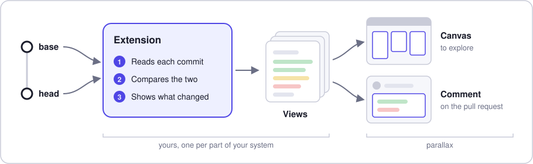
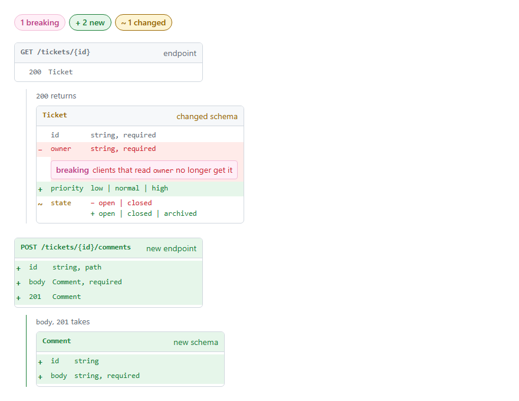

<h1 align="center"><picture><source media="(prefers-color-scheme: dark)" srcset="docs/logo-dark.svg"></picture></h1>

<p align="center">See what a change does to each part of your system.</p>

More and more code is written by AI agents on their own and reviewed by a person afterwards. To review a change well,
that person needs a clear view of what it means for the application. What that view is depends on the application:
the endpoints an API gains, the tables a schema loses, how a screen looks now, how the code fits together.

Parallax was made to help the person in the loop. It doesn't decide what the view is: it makes it possible to build the
views your application needs, one per part, and puts them in front of the reviewer on every change.

The views are deterministic. No agent decides what changed: each part is read at both commits and compared, so the same
change always shows the same way, and the reviewer can trust what they see.

## How it works

<p align="center"><picture><source media="(prefers-color-scheme: dark)" srcset="docs/how-it-works-dark.svg"></picture></p>

You write an extension for each part of your system. Parallax runs them and shows their views in two places:

- **On your machine**: a canvas with every view of the change side by side.
- **On every pull request**: a comment that shows each view, kept up to date. See
  [parallax's own pull requests](https://github.com/DavidOpDeBeeck/parallax/pulls).

In the comment a view is a picture. On the canvas it's a small application you can use: click through the screens
that changed, open an endpoint, follow a relation. Each view can be in your own style. See
[the examples](examples/README.md).

## Get started

Copy the skills under [`skills/parallax-extension`](skills/parallax-extension) and ask your agent to set parallax up. It builds your design first, then an extension per part.

Draw a change on your machine:

```bash
npx --yes github:DavidOpDeBeeck/parallax#main --base origin/main --head HEAD --open
```

Comment on every pull request:

```yaml
on: pull_request
concurrency:
  group: parallax-${{ github.event.pull_request.number }}
  cancel-in-progress: true
jobs:
  parallax:
    runs-on: ubuntu-latest
    permissions:
      contents: read
      pull-requests: write
    steps:
      - uses: actions/checkout@v4
        with:
          fetch-depth: 0
      - uses: actions/setup-node@v4
        with:
          node-version: "24"
      - run: npm ci
      - uses: DavidOpDeBeeck/parallax@main
        with:
          attach-token: ${{ secrets.PARALLAX_ATTACH_TOKEN }}
```

`npm ci` installs your views' packages; use your project's own install command. `attach-token` is a token of a person or bot account that can push to the repository (with Contents Read and Write
permission); it attaches the pictures.

## Examples

A few views parallax draws its own pull requests with. They're small on purpose: a starting point, not the limit.
Think about how a change is best seen in your own application: a schema as a diagram, a workflow as the steps it now
takes, a pricing rule as prices before and after, a permission as who can now do what. How these examples are built is
in [the examples](examples/README.md).

### Code

The files a change touched, grouped by folder and sized by the lines added and removed.

<picture><source media="(prefers-color-scheme: dark)" srcset="examples/pictures/code-dark.png"></picture>

### API

What changed in an OpenAPI specification: the endpoints and schemas that are new or changed, and where a client would
break.

<picture><source media="(prefers-color-scheme: dark)" srcset="examples/pictures/openapi-dark.png"></picture>

### Screens

The application's screens at both commits, with what changed outlined.

<picture><source media="(prefers-color-scheme: dark)" srcset="examples/pictures/screens-dark.png"></picture>
