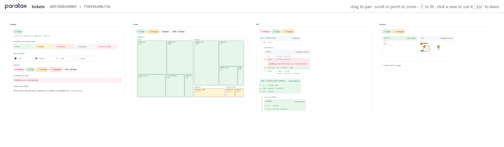

<h1 align="center"><picture><source media="(prefers-color-scheme: dark)" srcset="docs/logo-dark.svg"></picture></h1>

<p align="center">See what a change does to each part of your system, before you read the diff.</p>

- [What you get](#what-you-get)
- [How it works](#how-it-works)
- [Get started](#get-started)
- [Examples](#examples)

## What you get

- **A comment on every pull request**: a picture per view updated on every push. See [parallax's own pull requests](https://github.com/DavidOpDeBeeck/parallax/pulls).
- **A canvas**: every view of the change in one HTML file, to pan, zoom and click into.
- **Views in your own look**: an extension per part of your system (the API, the schema, the screens, the code) shows what changed the way that part is best seen. See [the examples](examples/README.md).

## How it works

```
base commit ─▶ extract ─▶ snapshot ─┐
                                    ├─▶ compare ─▶ delta ─▶ show ─▶ views ─▶ canvas, comment
head commit ─▶ extract ─▶ snapshot ─┘
             └──────────────────────── extension ─────────────────────┘   └───── core ─────┘
```

An extension reads its part of the system at both commits, says what changed, and shows it as a page of HTML.
Parallax runs the extensions and puts their views on the canvas and in the pull request.

## Get started

Copy the skills under [`skills/parallax-extension`](skills/parallax-extension) and ask your agent to set parallax up. It builds your design first, then an extension per part.

Draw a change on your machine:

```bash
npx --yes github:DavidOpDeBeeck/parallax#main --base origin/main --head HEAD --open
```

Comment on every pull request:

```yaml
on: pull_request
concurrency:
  group: parallax-${{ github.event.pull_request.number }}
  cancel-in-progress: true
jobs:
  parallax:
    runs-on: ubuntu-latest
    permissions:
      contents: read
      pull-requests: write
    steps:
      - uses: actions/checkout@v4
        with:
          fetch-depth: 0
      - uses: actions/setup-node@v4
        with:
          node-version: "24"
      - run: npm ci
      - uses: DavidOpDeBeeck/parallax@main
        with:
          attach-token: ${{ secrets.PARALLAX_ATTACH_TOKEN }}
```

`npm ci` installs your views' packages; use your project's own install command. `attach-token` is a token of a person
 or bot account that can push to the repository; it attaches the pictures.

How parallax behaves in detail is in [the specification](docs/spec.md).

## Examples

<p align="center"><picture><source media="(prefers-color-scheme: dark)" srcset="docs/canvas-dark.png"></picture></p>
