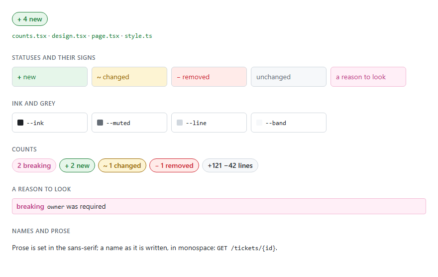
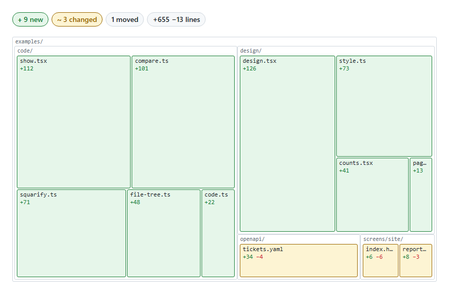
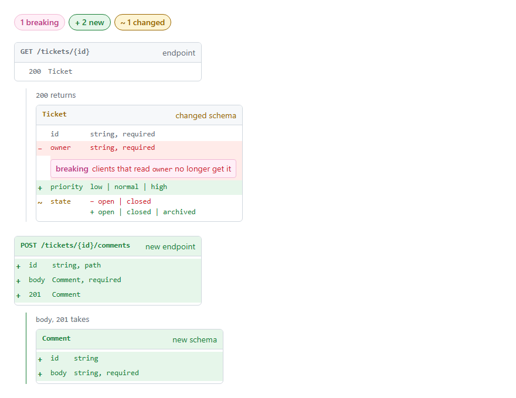
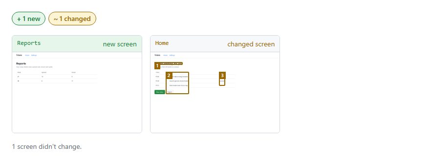

# Examples

What parallax can show, for ideas, and the playground parallax draws its own pull requests with. They are laid out the
way [the skill](../skills/parallax-extension/SKILL.md) lays out a project's `parallax/` folder; helpers several of them
use are in [`tools`](tools).

## design

<picture><source media="(prefers-color-scheme: dark)" srcset="pictures/design-dark.png"></picture>

The look every view is built from, and the extension that shows it when a change touches it: the files that changed,
then every part as it now is.

## code

<picture><source media="(prefers-color-scheme: dark)" srcset="pictures/code-dark.png"></picture>

The files a change touched, from git, so it fits every repository: folders as groups, files as tiles as large as their
lines added and removed, lock files left out. Later: tests marked apart, and many moves kept to one box.

## openapi

<picture><source media="(prefers-color-scheme: dark)" srcset="pictures/openapi-dark.png"></picture>

What changed in an OpenAPI document, as cards: each endpoint and schema that changed, the unchanged ones that use them,
and a `breaking` marker where a client would break. The cards view, in `cards/`, fits anything with parts: tables and
columns, messages and fields.

## screens

<picture><source media="(prefers-color-scheme: dark)" srcset="pictures/screens-dark.png"></picture>

An application's screens, pictured by its own step at each commit (here `take-screenshots.ts`, in Playwright's
Chromium: `pnpm exec playwright install chromium`), compared by pixels, and shown as a contact sheet with each change
outlined. Later: each change said in words, and what differs on every run masked.
